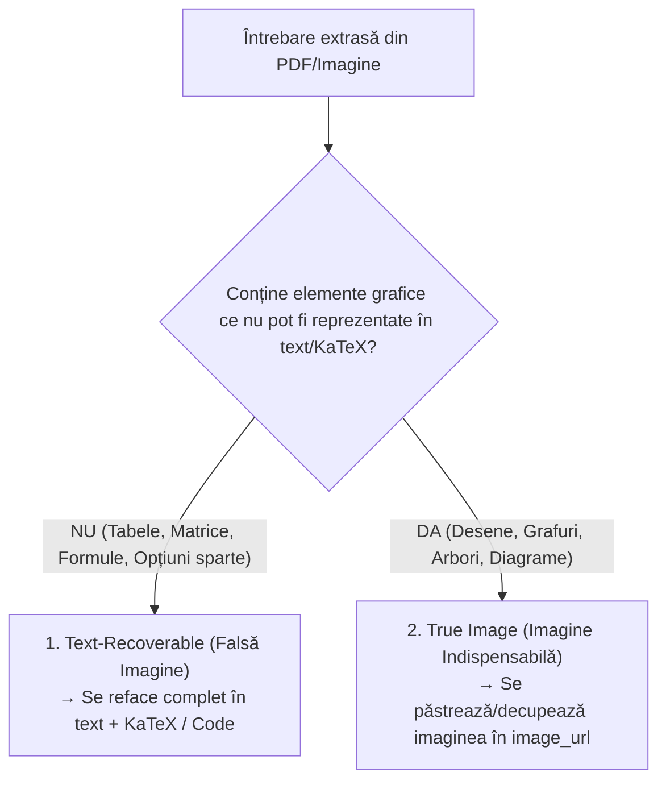

# Ghid Exhaustiv de Standardizare și Formatare a Întrebărilor (PDF / Imagini)
### Platforma AcaDE-QUIZ — Standard Didactic, Tehnic și Estetic

Acest document sintetizează **toate regulile, standardele, bunele practici și convențiile** stabilite pentru extragerea, curățarea, formatarea estetică, verificarea matematică și structurarea întrebărilor provenite din scanări, PDF-uri de admitere (Poli, ATM, UNIBUC, UBB) și imagini.

---

## 1. Extragerea și Curățarea Textului Brut (OCR Cleanup)

La conversia din PDF sau scanare apar frecvent anomalii de conversie. Fiecare întrebare trebuie curățată după următoarele reguli stricte:

### 1.1. Eliminarea Metadatelor Parazite
- **Numere de variantă sau problemă**: Eliminați antetele de tipul `Varianta 11`, `V24 N8`, `Subiectul I. 1.`, numerele de pagină izolate (ex: `241`) sau prefixele de punctaj (`(3p)`).
- **Etichete redundante de limbaj**: Eliminați textele repetitive din corpul enunțului precum `Limbajul C/C++`, `Limbajul Pascal`, `Limbajul C++`, păstrând doar enunțul propriu-zis și codul în limbajul țintă.
- **Opțiuni lipite în enunț**: Eliminați fragmentele de opțiuni migrate în enunț la parsare (ex: `a) I b) I și II c) II...`).

### 1.2. Normalizarea Textului și a Semnelor Tipografice
- **Diacritice românești complete**: Toate enunțurile, codul pseudocod și indiciile trebuie să folosească diacritice corecte cu virgulă dedesubt (`ș`, `ț`, `ă`, `â`, `î`), nu caractere turcești/sedilă (`ş`, `ţ`).
- **Ghilimele**:
  - În textul narativ: se folosesc ghilimelele românești `„...”`.
  - În fragmente de cod sau literali de caractere/șiruri: se folosesc ghilimele drepte ASCII standard (`"..."` pentru șiruri, `'...'` pentru caractere), eliminând smart quotes (`”`, `“`, `’`, `‘`).
- **Problema de Newline (`\n`)**:
  - Eliminați concatenările bruște cauzate de împărțirea pe coloane din PDF (unde cuvintele erau lipite, ex: `într-un tablou va riabile`).
  - Asigurați-vă că nu rămân secvențe textuale literale `\n` sau `\r\n` afișate brut în UI, ci pauze reale de rând.
- **Caractere de control**: Eliminați orice caracter invizibil sau byte nul (ex: `\u0000`), care provoacă erori fatale la scrierea în PostgreSQL/Supabase.

---

## 2. Standardul Matematic & KaTeX

Formulele matematice trebuie să fie impecabile, lizibile și consistente pe orice dispozitiv.

### 2.1. Regula de Aur împotriva Duplicării KaTeX
- **Textul unei formule matematice NU se repetă în format text simplu** alături de blocul KaTeX.
- Delimitare strictă:
  - Formule inline: `$expresie$` (ex: `$i + j = n + 1$`).
  - Formule display (centrate): `$$expresie$$` sau `\[ expresie \]`.
- **Evitarea conflictului cu simbolul dolar**: Dacă caracterul `$` apare ca literal (ex: afișarea caracterului `$$$$$` pe ecran), acesta trebuie escapat ca `\$` sau inclus în backticks (`` `$` ``), pentru a nu declanșa parserul KaTeX.

### 2.2. Convenții de Notație Matematică
| Element | Notație Recomandată KaTeX | Exemplu Randat |
| :--- | :--- | :--- |
| **Complexități** | `$\mathcal{O}(n \log n)$`, `$\mathcal{O}(m + n)$`, `$\mathcal{O}(1)$` | $\mathcal{O}(n \log n)$ |
| **Sume și Produse** | `$\sum_{i=1}^n i$`, `$\prod_{k=1}^m x_k$` | $\sum_{i=1}^n i$ |
| **Combinatorică** | `$\binom{n}{k}$` sau `$C_n^k$`, `$A_n^k$`, `$P_n$` | $\binom{n}{k}$ |
| **Fracții și Rădăcini** | `$\frac{a + b}{2}$`, `$\sqrt[3]{n}$`, `$\lfloor x \rfloor$` | $\frac{a+b}{2}, \sqrt[3]{n}$ |
| **Recurențe & Sisteme** | `\begin{cases} expr_1 & \text{caz 1} \\ expr_2 & \text{caz 2} \end{cases}` | $\begin{cases} a & \dots \\ b & \dots \end{cases}$ |
| **Indici în Text** | `$a[i][j]$`, `$v[k]$`, `$n - 1$`, `$2^n - 1$` | $a[i][j], 2^n - 1$ |

---

## 3. Standardul pentru Cod & Pseudocod

Structura logică a programelor trebuie să fie perfect aliniată și conformă cu programa de examen.

### 3.1. Separarea Câmpurilor `text` și `code`
- Câmpul `text`: Conține **doar enunțul cerinței**.
- Câmpul `code`: Conține **doar secvența de cod/algoritmul**, fără introduceri de tipul `Limbajul C++:`.
- Dacă cerința nu include cod, câmpul `code` este setat explicit la `null`.

### 3.2. Standardul Oficial de Pseudocod (Admitere Poli / ATM)
- **Operatorul de atribuire**: Se folosește săgeata standard spre stânga `←` (`U+2190`), cu spațiere aerisită în jur:
  - `i ← 1, n, 1` (nu `i<-1,n,1`)
  - `a[i][j] ← j + 1` (nu `a[i][j]<-j+1` sau `a[i][j]=j+1`)
- **Cuvinte cheie cu diacritice**:
  - `întreg`, `real`, `caracter`
  - `citește`, `scrie`
  - `dacă ... atunci ... altfel`
  - `pentru ... execută ... sfârșit_pentru`
  - `cât_timp ... execută ... sfârșit_cât_timp`
  - `repetă ... până_când`
- **Indentare**: Indentare strictă la **4 spații** pentru orice bloc imbricat.

### 3.3. Standardul C++
- Cod compact, conform standardelor ISO C++:
  - Indentare la 4 spații.
  - Acolade deschise/închise aliniate coerent.
  - Nume de variabile, funcții de bibliotecă (`strlen`, `strcpy`, `strtok`) și expresii scurte menționate în enunț delimitate întotdeauna prin backticks (ex: `int &a`).

### 3.4. Formatarea Matricelor în Blocul `code`
- Pentru matrice numerice (precum problema #246), se folosește **spațiere tabulară uniformă cu 2 spații între coloane**:
  ```text
  1  2  3  4  5  6  7  8  8
  1  2  3  4  5  6  8  8  8
  1  2  3  4  5  8  8  8  9
  8  8  8  9  9  9  9  9  9
  ```

---

## 4. Structurarea Opțiunilor de Răspuns (`options_json`)

- **Format**: Array JSON de șiruri de caractere (`["varianta A", "varianta B", ...]`).
- **Dimensiune**: 
  - Subiecte Politehnică: de regulă **6 variante**.
  - Subiecte Academie / Bacalaureat: de regulă **4 variante**.
- **Fără prefixe literale**: Variantele NU trebuie să includă literele de identificare în interiorul textului (ex: scrieți `"\mathcal{O}(n)"`, NU `"a) \mathcal{O}(n)"`). Litera este generată automat de UI-ul aplicației.
- **Reguli KaTeX în opțiuni**: Se aplică aceleași rigori matematice ca în enunț.

---

## 5. Cheia de Răspuns (`correct_index`)

- **Indexare**: `0-based` (`0` = prima opțiune / A, `1` = a doua opțiune / B, etc.).
- **Regula verificării algoritmice**:
  > [!IMPORTANT]
  > Cheia din baremele oficiale scanate sau din PDF poate fi greșită sau decalată la OCR (așa cum s-a dovedit la problema #246, unde figura opțiunea C în loc de B). 
  > Fiecare problemă trebuie evaluată matematic / simulată algoritmic înainte de salvarea cheii finale.

---

## 6. Standardul Pedagogic pentru Indicii (`hint`)

Conform preferinței stabilite, stilul aprobat este **Metodic / Orientativ**:

1. **Fără spoiler**:
   - Nu se indică niciodată direct litera de răspuns (*„Răspunsul este B”*).
   - Nu se oferă rezolvarea aritmetică completă gata calculată.
2. **Rolul didactic**:
   - Oferă „declicul” logic: teorema matematică (lema strângerilor de mână, formula lui Legendre, suma Gauss), comportamentul funcției C++ (transmitere prin referință vs valoare, scurtcircuitarea operatorilor `&&` și `||`, trunchierea împărțirii întregi), sau invariantul de ciclare.
3. **Format**:
   - 1 până la 3 fraze concise.
   - Variabile specifice menționate din enunț (`n`, `v`, `k`).
   - Formule KaTeX și backticks pentru cod.

---

## 7. Clasificarea Întrebărilor care conțin Imagini (`image_url`)

Întrebările extrase din PDF se împart în două categorii majore:



### 7.1. Categoria 1: Falsă Imagine (Text-Recoverable)
Întrebări care au fost marcate greșit ca având imagine din cauza erorilor de parsare PDF:
- Matrice de adiacență sau tabele de valori (pot fi formatate în KaTeX sau blocuri de cod).
- Formule matematice complexe cu acolade mari sau fracții etajate (se scriu nativ în KaTeX).
- Opțiuni multiple cu tabele (se structurează curat în `options_json`).
- *Aceste întrebări devin 100% native (fără dependență de fișiere imagine externe).*

### 7.2. Categoria 2: Imagine Reală (True Image)
Întrebări unde desenul sau imaginea este indispensabilă din punct de vedere grafic:
- Diagrame de grafuri (noduri și muchii desenate spațial).
- Reprezentări vizuale de arbori binari sau grafuri orientate.
- Diagrame de flux (schemă logică).
- Desene geometrice sau împărțiri grafice ale matricelor (ex: cele 4 cadrane / zone hașurate).
- Scheme de circuite sau porți logice.

> [!IMPORTANT]
> **Regula de procesare pentru întrebările cu imagine grafică (True Image):**
> 1. **Delimitare Text vs. Imagine**: Se extrage și se formatează complet enunțul textual (`text`), eventualul cod (`code`), opțiunile curate (`options_json`), răspunsul corect verificat (`correct_index`), categoria și indiciul didactic (`hint`).
> 2. **Trimitere în `waiting_questions` cu `image_url: null`**: Întrebarea este salvată și trimisă în tabela de așteptare fără fișier atașat (`image_url: null`), astfel încât profesorul/administratorul să poată asocia și încărca direct imaginea grafică ulterior din panoul de administrare.
